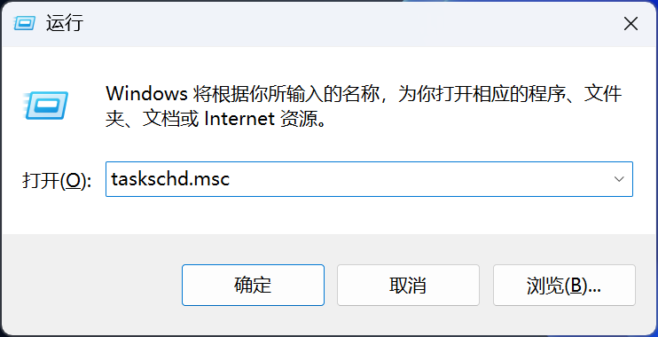
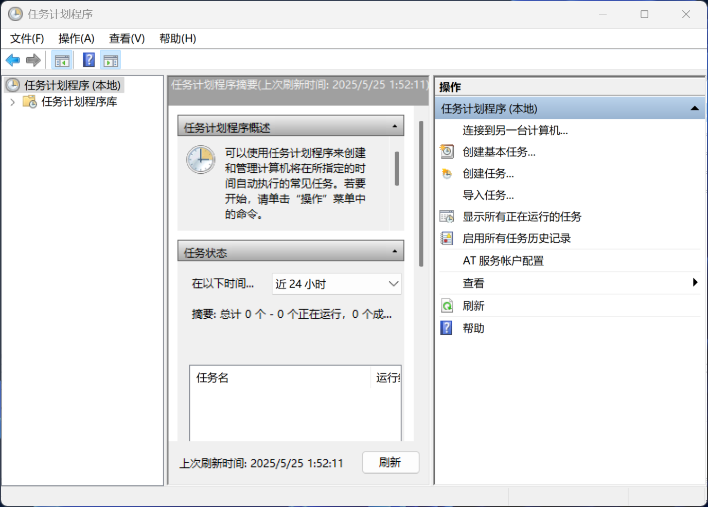
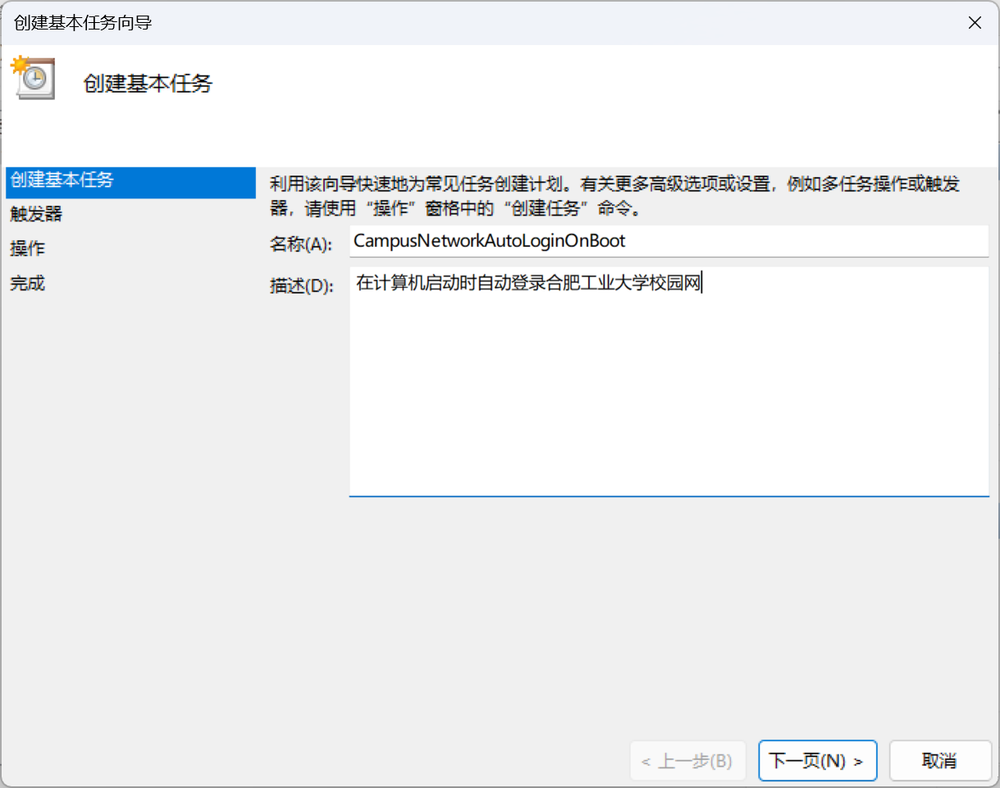
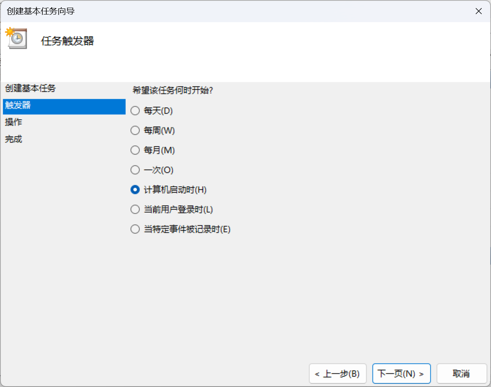
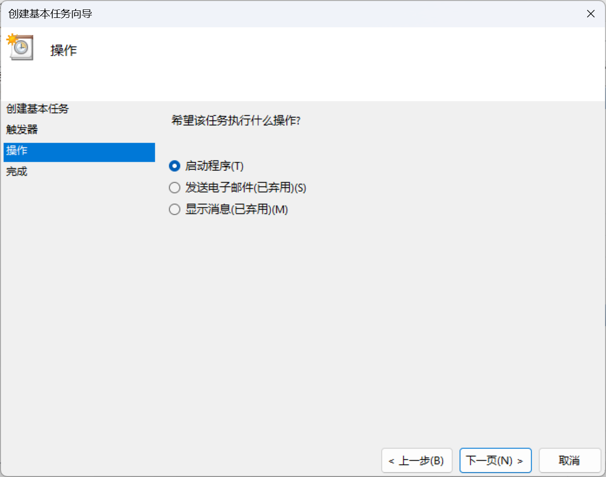
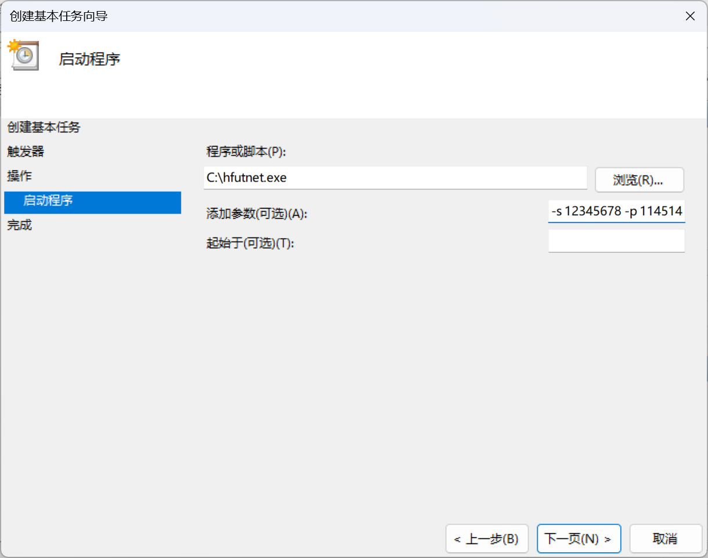
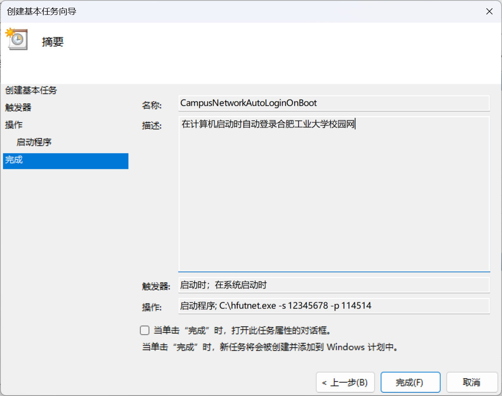
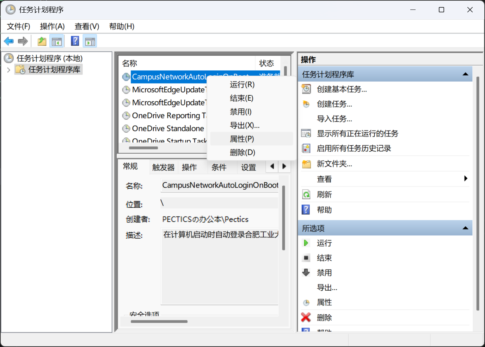
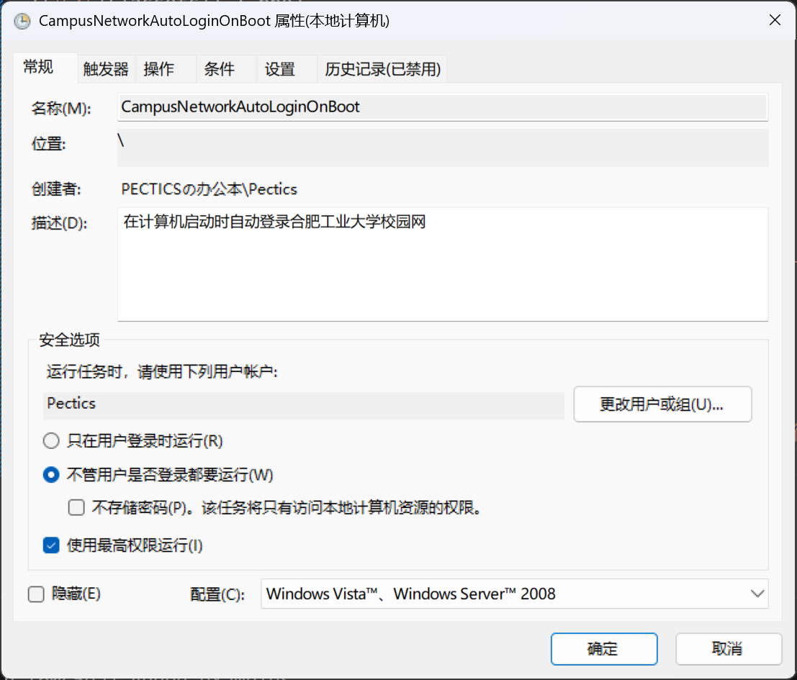

<div align="center">

# 🌐 hfutnet

**合肥工业大学校园网快速连接工具**

[](https://opensource.org/licenses/MIT)
[](https://www.microsoft.com/windows)
[](https://isocpp.org/)

一个简单高效的命令行工具，用于快速登录和登出合肥工业大学校园网

</div>

---

## 📋 目录

- [功能特性](#功能特性)
- [快速开始](#快速开始)
  - [使用方法](#使用方法)
  - [命令示例](#命令示例)
- [使用场景](#使用场景)
  - [开机自动登录](#开机自动登录)
- [编译指南](#编译指南)
- [更新日志](#更新日志)
- [许可证](#许可证)
- [贡献](#贡献)

---

## ✨ 功能特性

- ✅ **快速登录** - 一键连接校园网，无需打开浏览器
- 🔓 **快速登出** - 简单注销校园网连接
- 🤖 **自动化支持** - 可配合任务计划程序实现开机自动登录
- 🛠️ **轻量级** - 单文件可执行程序，无需额外依赖
- ⚡ **高效** - 使用 C++ 编写，运行速度快

---

## 🎯 开发背景

工大校园网的连接方式比较原始，无法在插拔网线前后保存连接会话、实现自动登录。为了简化和自动化这一过程，开发了这个实用工具。

---

## 🚀 快速开始

### 使用方法

```cmd
# 登录校园网（默认操作）
hfutnet.exe <学号> <密码> [--login | -i]

# 登出校园网
hfutnet.exe [--logout | -o]
```

### 命令示例

| 操作 | 命令 | 说明 |
|------|------|------|
| 🔐 登录 | `hfutnet.exe 2024213492 yourpassword` | 使用学号和密码登录 |
| 🔐 登录（显式） | `hfutnet.exe 2024213492 yourpassword --login` | 显式指定登录操作 |
| 🔓 登出 | `hfutnet.exe --logout` | 登出当前网络连接 |

> **提示**: 如果不指定操作选项，程序默认执行登录操作。

---

## 💡 使用场景

### 开机自动登录

通过 Windows 任务计划程序，可以实现开机自动连接校园网。

<details>
<summary><b>📖 点击查看详细配置步骤</b></summary>

#### 步骤 1: 准备工作
将 `hfutnet.exe` 放在固定目录，例如 `C:\Tools\hfutnet.exe`

#### 步骤 2: 打开任务计划程序
按 `Win + R`，输入 `taskschd.msc`，打开任务计划程序

<p align="center">
  
  <br>
  <em>打开运行对话框</em>
</p>

<p align="center">
  
  <br>
  <em>任务计划程序主界面</em>
</p>

#### 步骤 3: 创建基本任务
选择左侧 `任务计划程序库`，在右侧点击 `创建基本任务`

<p align="center">
  
  <br>
  <em>创建新任务</em>
</p>

#### 步骤 4: 设置任务名称
输入任务名称，例如 `CampusNetworkAutoLogin`，点击 `下一页`

#### 步骤 5: 选择触发器
选择 `当计算机启动时`，点击 `下一页`

<p align="center">
  
  <br>
  <em>设置开机触发</em>
</p>

#### 步骤 6: 选择操作
选择 `启动程序`，点击 `下一页`

<p align="center">
  
  <br>
  <em>选择启动程序操作</em>
</p>

#### 步骤 7: 配置程序
- **程序/脚本**: 输入程序的完整路径（如 `C:\Tools\hfutnet.exe`）
- **添加参数**: 输入 `<你的学号> <你的密码>`
- 点击 `下一页`

<p align="center">
  
  <br>
  <em>配置程序路径和参数</em>
</p>

#### 步骤 8: 完成创建
点击 `完成` 按钮

<p align="center">
  
  <br>
  <em>确认任务创建</em>
</p>

#### 步骤 9: 高级配置
右键点击刚创建的任务，选择 `属性`

<p align="center">
  
  <br>
  <em>打开任务属性</em>
</p>

#### 步骤 10: 权限设置
在 `常规` 选项卡中：
- ✅ 选择 `不管用户是否登录都要运行`
- ✅ 勾选 `使用最高权限运行`
- 点击 `确定`

<p align="center">
  
  <br>
  <em>配置运行权限</em>
</p>

#### 步骤 11: 确认保存
输入管理员密码确认保存

> ✅ **完成！** 现在每次开机时系统会自动登录校园网。

</details>

---

## 🔧 编译指南

### 环境要求

| 组件 | 说明 |
|------|------|
| 🖥️ **操作系统** | Windows 10/11 |
| 🔨 **编译器** | MinGW-w64 (支持 C++17) |
| 📦 **版本控制** | Git |

### 编译步骤

```cmd
# 1. 克隆仓库
git clone https://github.com/Pectics/hfutnet.git
cd hfutnet

# 2. 编译项目
g++ hfutnet.cpp hfutnet/consts.h hfutnet/utils.hpp -o hfutnet.exe -lwininet -lcrypt32

# 3. 运行程序
hfutnet.exe <学号> <密码>
```

> **注意**: 编译时需要链接 `wininet` 和 `crypt32` 库。

---

## 📝 更新日志

| 日期 | 更新内容 |
|------|----------|
| **2025-12-21** | 🔄 彻底重构代码结构，拆分常量和工具函数到单独文件，适配上游变化 |
| **2025-09-20** | 🔒 为 `sid` 和 `password` 参数添加 URL 编码预处理 |
| **2025-05-25** | 🎉 首次版本提交 |

---

## 📄 许可证

本项目采用 [MIT 许可证](LICENSE) 开源。

---

## 🤝 贡献

欢迎提交 Issue 和 Pull Request！

---

<div align="center">
  <sub>Made with ❤️ by <a href="https://github.com/Pectics">Pectics</a></sub>
</div>